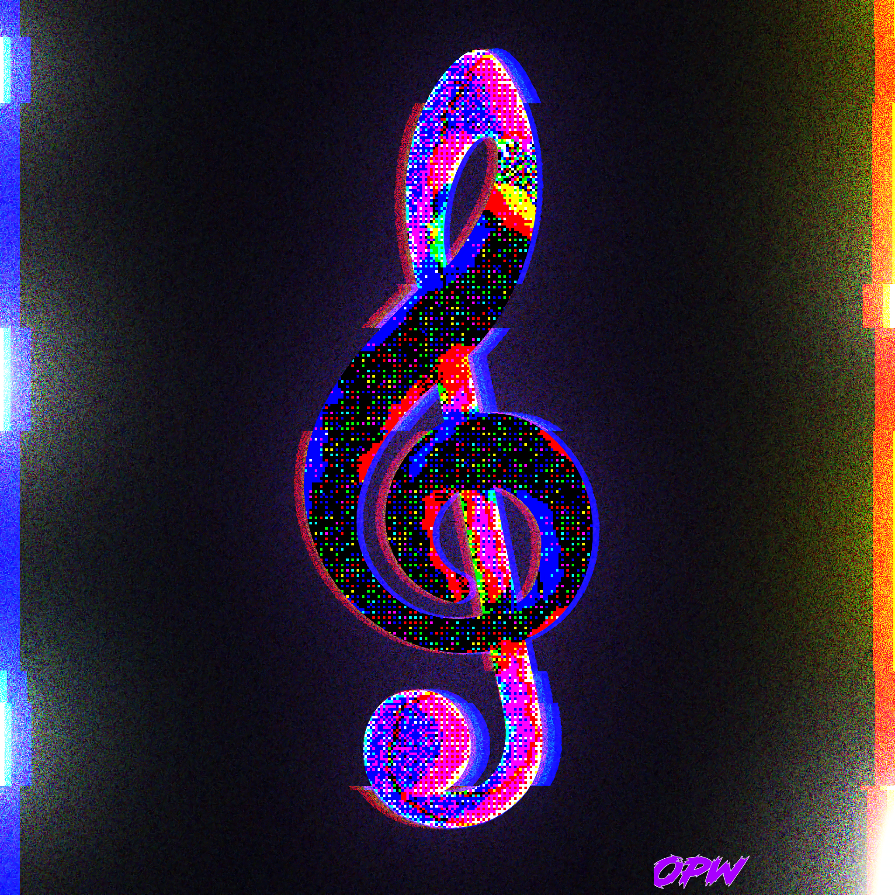
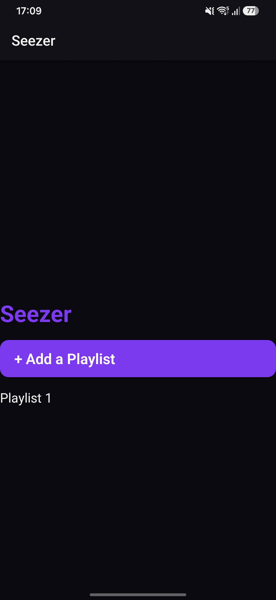
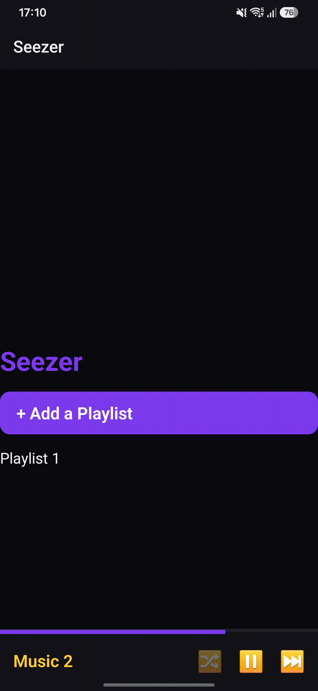
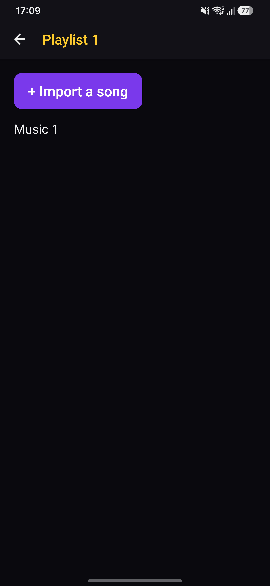
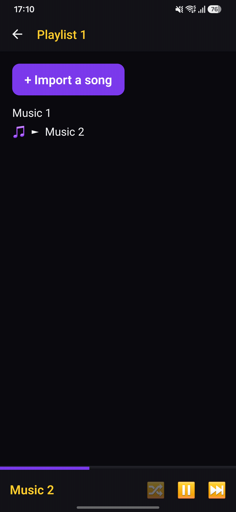

<p align="center">
 
</p>

<h1 align="center"># 🎵 Seezer</h1>

<p align="center">
 A mobile music streaming app built with React Native and Expo.
</p>


## ✨ Features

- Stream Music directly from your phone
- Create and manage playlists
- Clean interface designed for mobile

## 📸 Screenshots

<p>
 
 
 
 
</p>

## 🚀​ Getting Started

### ​🛠️​ Prerequisites

- [Node.js](https://node.js.org/) (version 18 or later)
- The [Expo Go](https://espo.dev/go) app on your phone

### ​🛰️​ Installation

``` bash
# Clone the repository
git clone https://github.com/Opw2448/Seezer.git

# Go into the project folder
cd Seezer

# Install dependencies
npm install

# Start the app
npx expo start
```

Then scan the QR code with Expo Go (Android) or the Camera app (ios)

## ⚠️​ Warning

I would ask you to respect copyright and only import sounds that are not copyright or for which you have paid a licence to listen them.

## 📖​ More Information

This my first developpement project. Unfortunately, i did a lot of vibecoding. If you have any questions or suggestions, please don't hesitate to ask to me.